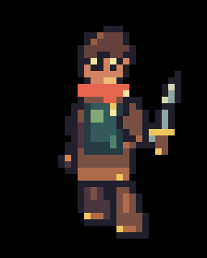
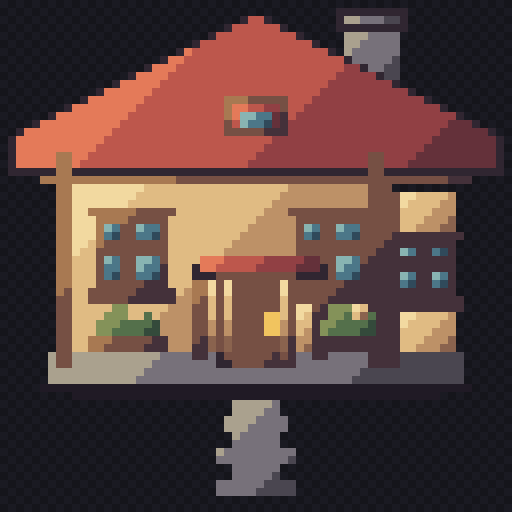

# PixelHand

**Pixel art, placed with intent. Built for AI agents.**

[](https://github.com/SirLichDevCraft/PixelHand/actions/workflows/test.yml)
[](LICENSE)
[](package.json)

An open-source engine for creating sprites, animation, and game art through **MCP, CLI, or JavaScript**. Local and API-driven models work with palette-indexed pixels, editable text grids, and visual feedback. Every change can be inspected, revised, and saved as source.

[Get started](#get-started) · [Connect an agent](#connect-an-agent) · [Documentation](docs/README.md) · [Contribute](CONTRIBUTING.md)

## Made with PixelHand

### Rowan · eight-direction walk

An original 32 × 40 character with eight authored facings, four walk poses, layered limbs, and frame-by-frame review.



[Contact sheet](showcase/hero/preview/walk-contact.png) · [Individual GIFs and audit results](showcase/hero/README.md) · [Authoring script](bench/showcase-hero.js)

### Farmhouse · architectural study

A building study with material ramps, warm lighting, and editable pixel source.



[Editable project](showcase/farmhouse/art) · [Authoring script](bench/showcase-farmhouse.js)

These examples were authored and iterated with the engine. They demonstrate the drawing workflow; they are not autonomous model benchmark results.

## What you can build

| Capability | Tools and feedback |
| --- | --- |
| Sprites and props | Named pixel maps, shapes, fills, outlines, masks, protected regions, and atomic edit batches |
| Consistent art direction | Style bibles, material ramps, palette rules, and saved visual preferences |
| Directional animation | Authored rigs, joint chains, planted contacts, eight-facing projection, and clip validation |
| Tiles and environments | Tile rules, reusable parts, materials, and scene composition |
| Visual review | Native-scale renders, silhouettes, value maps, differences, contact sheets, and GIF playback |
| Agent workflows | Typed tool contracts, compact discovery, saved briefs, recovery, and bounded local/API execution |

The core has **zero runtime dependencies**. Projects store their art in ordinary files you can version, diff, and carry into another tool.

## Get started

Requires **Node.js 20.3 or newer** and Git.

```sh
git clone https://github.com/SirLichDevCraft/PixelHand.git
cd PixelHand
node examples/lantern.js
```

This creates an original lantern project in `out/lantern-example/`, including saved pixel source, a PNG export, and review images. Open `out/lantern-example/out/lantern.png` to see the result. Supply a new destination for another run:

```sh
node examples/lantern.js /path/to/new-art-project
node src/cli.js help draw_named_map
```

No package installation or API key is needed for the authored example. To install CLI commands from this checkout, see the [installation guide](docs/guide.md#installation).

## Connect an agent

PixelHand exposes a stdio MCP server. In Zed, add this to `settings.json`, replacing the path with your checkout. Windows paths can use forward slashes, for example `C:/repos/PixelHand/src/mcp.js`.

```json
{
  "context_servers": {
    "pixelhand": {
      "command": "node",
      "args": ["/absolute/path/to/PixelHand/src/mcp.js"],
      "env": { "PIXELHAND_TOOLSET": "core" }
    }
  }
}
```

The compact `core` profile provides discovery and everyday editing. An agent can find specialist tools with `tool_search`, inspect their contracts with `tool_help`, and execute them through `tool_call`.

Start a new art project with `project_init`; resume one with `project_open`. Build from silhouette to detail, inspect the renders, and review every animation frame and facing before export.

For standalone model execution, configuration examples support [Ollama](configs/ollama.example.json), [LM Studio](configs/lmstudio.example.json), and [compatible API endpoints](configs/api.example.json). See [local and API inference](docs/guide.md#local-and-api-inference) for setup, budgets, and recovery.

## Development status

**0.2.0-rc.1 · release candidate.** Automated checks cover the engine, persistence, public interfaces, and provider adapters. Live local/API art-quality qualification remains open. Mechanical checks and recorded visual review are reported separately.

[Release gates](PRODUCTION.md) · [Roadmap](PLAN.md) · [Changelog](CHANGELOG.md) · [Architecture](docs/architecture.md)

```sh
npm test
npm run check
npm pack --dry-run
```

## Free to use

The code, documentation, and original artwork in this repository are released under the [MIT license](LICENSE). Use, modify, share, and sell them in personal or commercial projects, with no royalties, subscription, or expiry. Keep the license and copyright notice with copies or substantial portions you distribute.

PixelHand imposes no license or attribution requirement on new art you create with it. Reusing the included artwork follows its MIT terms. See [asset provenance](docs/provenance.md) for how imported assets are tracked.
