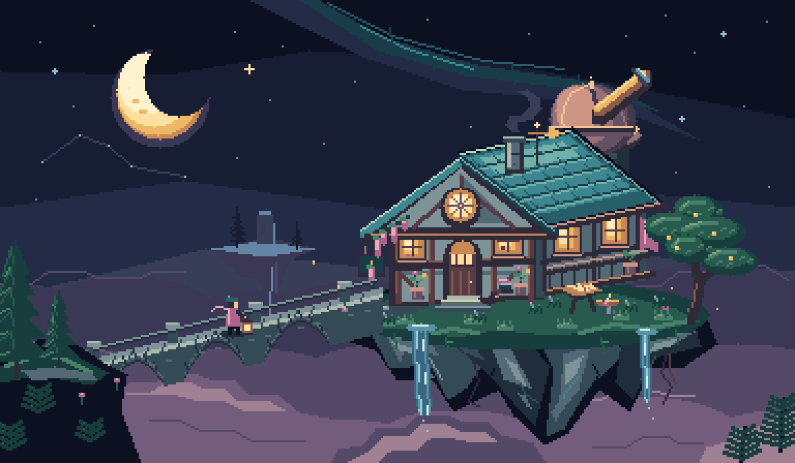

# The Starfall Archive

A library and observatory suspended above a sea of clouds. A lone courier approaches with a lantern; warm windows, an open atlas, a brass sundial, and a sleeping cat give the island a life beyond its silhouette.



## The artwork

- **Canvas:** 384 × 224 native pixels.
- **Palette:** 48 declared colors; 45 used in the finished scene.
- **Animation:** eight frames, 160 ms each, looping over 1.28 seconds.
- **Motion:** descending waterfall highlights, drifting fireflies, and intermittent starlight. The composition and camera stay fixed.
- **Source:** eight palette-indexed text cels, a style bible, a named palette, and an authored placement script.

The scene uses cool patinated roofing against warm brass and windows, with plum-colored clouds separating the foreground bridge, main island, and distant watchpost. Rock strata follow the cliff planes; shingles follow the roof pitch. Small details include flower pots, wisteria, books, a weather vane, and a telescope.

## Files

| File | Purpose |
| --- | --- |
| [starfall.gif](starfall.gif) | Animated preview at 3× integer scale |
| [preview.png](preview.png) | Still image at 3× integer scale |
| [native.png](native.png) | Original indexed PNG at game resolution |
| [animation.json](animation.json) | Frame order, dimensions, and timing |
| [art/](art) | Editable PixelHand project, including all eight cels |
| [Authoring script](../../bench/showcase-starfall.js) | Complete original composition and placement instructions |

## Rebuild

From the repository root:

```sh
node bench/showcase-starfall.js
```

The script builds a fresh project under ignored `out/`, then updates this directory's source and previews. It uses PixelHand's public JavaScript API to declare the project and palette, draw named pixel maps, save cels, and export PNG and GIF files. The still preview enlarges the engine's PNG with its own nearest-neighbor codec; it introduces no new colors.

This is an authored showcase, with no imported artwork or image-generation service. It demonstrates PixelHand's drawing and export workflow rather than autonomous model quality. The animation was checked across all eight frames with an independent decoder.

The source, animation, and images are available under the repository's [MIT license](../../LICENSE), including commercial reuse.
